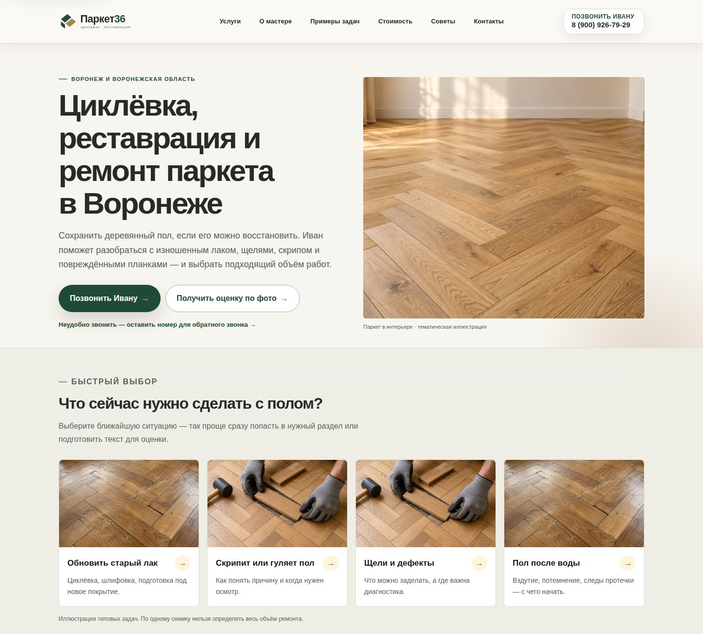
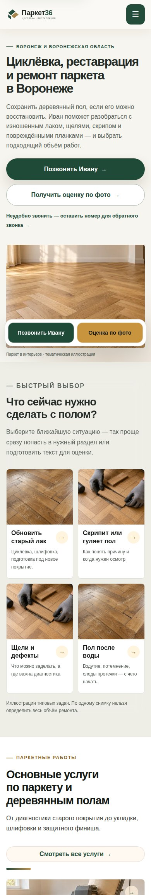

# Визуальная проверка главной

Снимки получены из штатного [Browser smoke SHA b9ec2a6](https://github.com/deputat36/parket36-site/actions/runs/38920328088). Это снимки реального рендеринга, не макеты. Сохранены верхние части страницы на ширинах 1440 и 390 px. Полные страницы, услуга, статья и контакты, включая 320 px, находятся в CI artifact.

После этого SHA исправлен порядок заголовков в перенесённых памятках внутренних страниц и добавлена изоляция временной сборки. Вёрстка главной не менялась.
